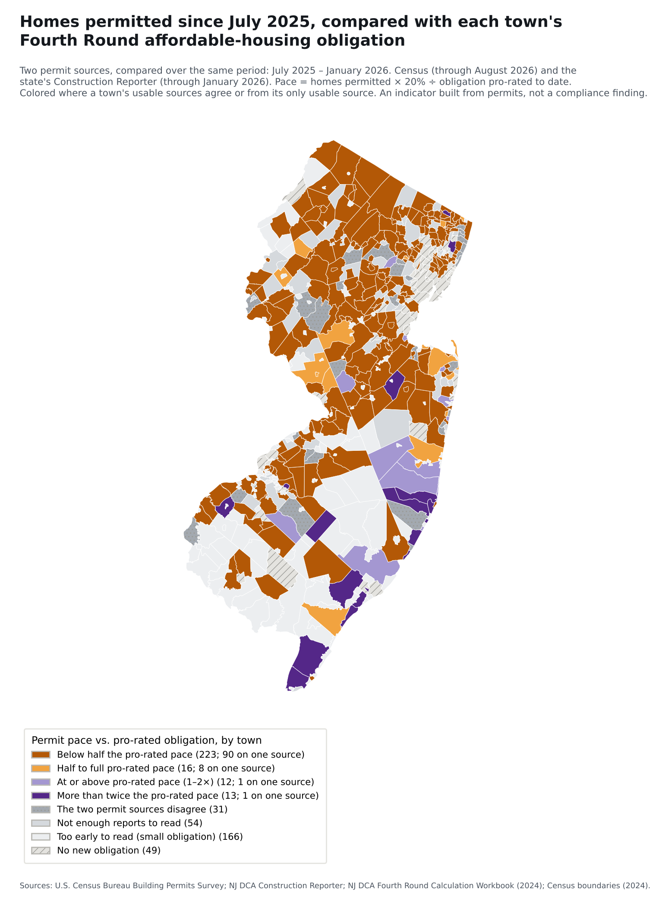
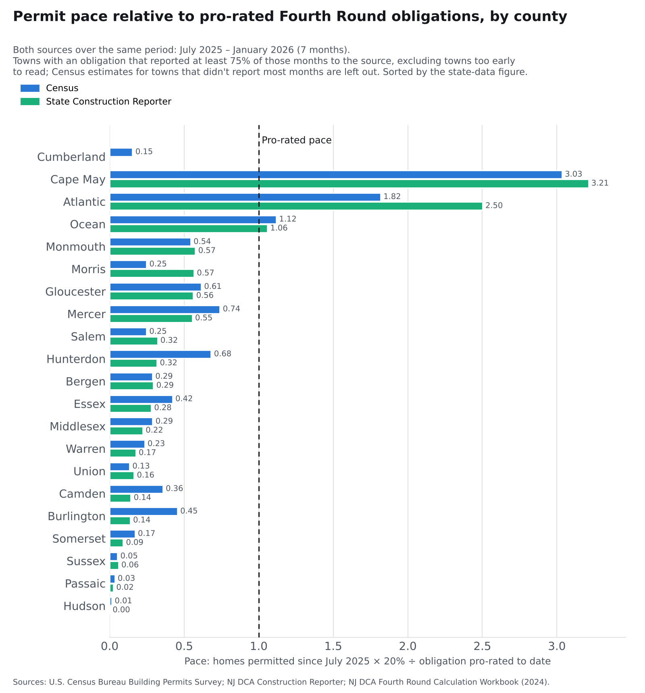

# Permit Pace and New Jersey's Fourth Round Affordable-Housing Obligations

**Swapnil Boyapati** · October 2026 · *Unassembled public records*, project 1

[](out/summary.json)
[](out/summary.json)
[](https://github.com/SBoyapati13/nj-housing-pace/actions/workflows/update.yml)
[](https://sboyapati13.github.io/nj-housing-pace/)

[](https://sboyapati13.github.io/nj-housing-pace/)

*Figure 1. Homes permitted since July 2025 in every New Jersey town, compared with its Fourth Round obligation pro-rated to date. Both permit sources are compared over the same period; a town is colored when its usable sources agree or from its only usable source, and gray when they disagree or can't be read. Redrawn automatically with each release. **Click the map to open the interactive version**, where you can search for a town and see both sources side by side.*

---

## Abstract

New Jersey's 2024 Affordable Housing Law assigns 515 municipalities a combined 80,798 units of new ("prospective need") affordable housing for 2025–2035 [3, 4, 6]. This project puts each town's obligation next to the homes it has permitted, and asks whether permitting is happening where the obligations are.

Town-level permit counts turn out to be the hard part. New Jersey has two public sources, and they often disagree:

- The **U.S. Census Bureau's Building Permits Survey** fills in towns that don't report with estimates. In New Jersey the estimated share of permitted homes has swung from under 1% (2019) to 38% (2015), and was 24–36% in each year from 2023 to 2025. Jersey City reported no months to Census in 2024 or 2025.
- The **state's Construction Reporter** marks towns that don't report as missing rather than estimating them, but runs about eight months behind, and some of its zeros are missing reports in disguise.
- For 2025 the two sources total 27,661 (Census, revised) and 19,865 (state, with 57 towns marked missing for the year; 18,973 if towns with a missing December report are also left out, as this project does). For individual towns that reported fully to both, they can differ several-fold: Wall Township 2023, 592 vs. 177.

So the project shows both sources side by side, uses a source for a town only when the town reported most months to it, compares the sources over the same period, and treats a town as unreadable when they disagree. At the first release under this method (Census data through August 2026, state data through January 2026):

- Homes permitted in obligated towns since July 2025, × 20%, came to **38%** of the obligation pro-rated to date on state data (313 towns with usable reports, July 2025 – January 2026) and **45%** on Census data (all obligated towns through August 2026, 36% of it Census estimates).
- Where both sources were usable for a town, they put it in the same class 164 times out of 195.
- **223 of 515** obligated towns are below half the pro-rated pace (133 on both sources agreeing, 90 on the only usable one). **251** can't be read yet: their sources disagree, they reported too few months, or their obligation is too small to read this early.
- About **36–37%** of all homes permitted were in the 49 towns that carry no new obligation, mostly by design (47 are Qualified Urban Aid municipalities).

**How to read this.** This is an indicator built from building permits. It doesn't assess whether any town is complying with its obligation: towns meet obligations in several ways permits don't capture (credits, 100%-affordable projects, adjustments), and compliance is decided through the Affordable Housing Dispute Resolution Program and the courts. A low permit pace can reflect land, infrastructure and market conditions as much as local policy, and plans adopted in 2025–26 may not show up in permits for some time.

This is a living analysis. A pipeline checks both permit sources and the state's completions data every week, rebuilds every figure when anything new is published, and reports when, and whether, the question can still be answered (§7.2). Every update is logged, and every number can be rebuilt from public files with one command. The method was corrected on October 13, 2026 after an error review, and again after an independent check of the correction; the CHANGELOG lists what was wrong, what changed, and which changes were made after seeing results.

<!-- LIVE:START -->
## Live status

*Rewritten automatically whenever either permit source publishes. Census data through August 2026; state data through January 2026. Every update is logged in `data/runs.jsonl`.*

**Interactive map:** https://sboyapati13.github.io/nj-housing-pace/ (search any town to see both sources side by side; switch between Fourth Round to date and the 2021–25 baseline).

**Pace since July 2025, towns with an obligation only**

| | State Construction Reporter | Census Building Permits Survey |
|---|---|---|
| Period | July 2025 – January 2026 (7 months) | July 2025 – August 2026 (14 months) |
| Towns counted | 313 with usable reports (holding 74% of the obligation) | all 514 with a Census record; 202 reported at least 75% of months |
| Homes permitted | 6,720 | 21,243, of which 36% are Census estimates |
| **Pace vs. pro-rated obligation** | **38%** | **45%** (towns that reported: 46%) |
| Towns below half the pro-rated pace (excluding towns too early to read) | 192 | 114 |
| Share of all permits in towns with no obligation | 36% | 37% |

Pace = homes permitted × 20% ÷ obligation pro-rated to date. The 20% is a yardstick, not a bound (see §3 and §6).

**Map classes** (Figure 1). Both sources are compared over the same period, July 2025 – January 2026 (7 months); a town is colored when its usable sources agree or from its only usable source.

| Class | Towns |
|---|---|
| Below half the pro-rated pace | 223 |
| Half to full pro-rated pace | 16 |
| At or above pro-rated pace (1–2×) | 12 |
| More than twice the pro-rated pace | 13 |
| The two permit sources disagree | 31 |
| Not enough reports to read | 54 |
| Too early to read (small obligation) | 166 |
| No new obligation | 49 |

Of the 264 colored obligated towns, 164 rest on both sources agreeing and 100 (38%) on one usable source. 74 colored towns have an obligation pro-rated over the shared period of under 5 affordable homes (the too-early test uses the longer Census period; see §6), and 19 are colored from Census alone with no homes actually reported (their Census figure is all estimates for the unreported months, or zero). Where both sources were usable (195 towns), they put the town in the same class 164 times and disagreed 31 times.

32 obligated towns have a state figure of 0 for the period that their Census reports don't confirm; those zeros are treated as not reported (§3, item 4).

**Best-year threshold.** Would reaching the obligation by June 2035 take more than permitting at the town's best fully reported year since 2015, every remaining year?
- At a 20% set-aside: yes for 265 of 505 towns on state data, 233 of 426 on Census data.
- Even if every new home were affordable: yes for 111 (state) and 92 (Census).
- This compares obligations with past building patterns. It doesn't assess compliance: rezoning, 100%-affordable projects, credits and other routes can exceed past patterns. It isn't shown on the map.

**Final obligation numbers.** 13 towns have a final or adopted number on file (10 recorded as settled, court-ordered or accepted as calculated; most of these statuses come from town documents describing the order, see `evidence` in `data/raw/obligation_final.csv`). Using those numbers in place of the state's calculation, pace is 39% on state data (vs. 38%) and 45% on Census data (vs. 45%).

**Reported completions** (certificates of occupancy, NJ DCA; through January 2026):
- 9,735 homes reported completed since July 2025 in the 384 towns not marked missing in the state's files.
- Over 2015–2024, reported completions equalled **71%** of homes permitted (state data, same agency and town codes), in the 282 towns that reported both every year. The gap mixes projects still under way, permits never built and incomplete reporting; the data can't separate them.
- Homes permitted in 2024–25 minus homes reported completed in 2024–25: **19,172** across 341 towns, a rough size of the recent pipeline.
- 90 towns are marked missing in the state's completions file for the latest full year and are left out.

First run under the current method: no earlier release to compare against yet.



*Figure 2. The same pace measure by county, both sources over the same period, counting only towns with usable reports to each source and leaving out towns too early to read.*

**System health.** Overall: **OK**

| Check | Status | Detail |
|---|---|---|
| round window | OK | Fourth Round active: month 14 of 120 (Census), 7 (state data). |
| census freshness | OK | Latest Census data is 2 months old (normal lag is 1–3). |
| state permits freshness | OK | Latest state permit data (NJ DCA) is 9 months old (normal lag is 8–10). |
| census format | OK | 41 columns (expected 41), 562 NJ places (expected 550+). |
| town match | OK | 564 of 564 towns matched to at least one permit source. |
| reporting coverage | OK | Towns holding 74% of the obligation have usable state permit data since July 2025, and 53% reported at least 75% of months to Census. Warns only when neither source covers 60%. |
| source agreement | OK | 164 of 195 towns with both sources usable fall in the same class; 31 disagree. |
| negative values | OK | 0 towns had negative homes permitted since July 2025 (clipped to 0). |
| obligation source | OK | DCA obligation workbook unchanged upstream. |
| completions freshness | OK | Latest completions data (NJ DCA certificates of occupancy) is 9 months old (normal lag is 8–10). Completions are a secondary layer. |
| proxy validity | MANUAL | Permits × 20% is a yardstick for affordable output, not a measure of it. Reviewed by hand each month (data/review_log.md). |

*Run history under the current method (last 12 updates; full log, including superseded methods, in `data/runs.jsonl`):*

| Census data through | State data through | Run date | Pace, state data | Pace, Census | Towns below half (map) |
|---|---|---|---|---|---|
| 2026-08 | 2026-01 | 2026-10-14 | 38% | 45% | 223 |
<!-- LIVE:END -->

## 1. Background

### 1.1 The Mount Laurel doctrine

In 1975 the New Jersey Supreme Court held that a developing municipality must, through its zoning, "presumptively make realistically possible an appropriate variety and choice of housing," at least to the extent of its "fair share of the present and prospective regional need therefor" [1, 67 N.J. at 174]. The Court strengthened the doctrine in 1983 [2], and the Fair Housing Act of 1985 and the Council on Affordable Housing (COAH) were then built to carry out that duty. After the Supreme Court declared COAH inoperative in 2015 [4, p. 5], obligations were set town by town in the courts until the 2024 reform.

The obligation is to provide a *realistic opportunity* for affordable housing, chiefly through zoning. It is not a quota of permits. That is why this project's measure is an indicator, not a compliance test.

### 1.2 The 2024 Affordable Housing Law

P.L.2024, c.2, signed March 20, 2024, replaced that system. The Legislature declared that "the Council on Affordable Housing shall be abolished" [3]. It moved the calculation to a fixed statutory formula run by the Department of Community Affairs (DCA) and created an Affordable Housing Dispute Resolution Program to settle challenges [3, 4]. Three features of the formula matter for this analysis.

**Regional need comes from household growth.** The law states that household change, "if positive, shall be divided by 2.5 to estimate the number of low- and moderate-income homes needed" [3]. DCA's application of this produced 84,698 units of regional prospective need statewide [4, p. 10].

**Urban-aid municipalities are exempt.** In the law's words: "If a municipality is a qualified urban aid municipality, the municipality shall be exempt from responsibility for any fair share prospective need obligation for the upcoming 10-year round" [3]. DCA identified 47 such municipalities in 13 counties [4, p. 10]. Two more towns (Tavistock and Walpack) have a calculated obligation of zero.

**Obligations are capped.** A town may lower its number to avoid an obligation requiring "a realistic opportunity for more than 1,000 housing units," or one exceeding "20 percent of the total number of households" [3; 4, p. 18]. After the cap, the statewide total is 80,798 [6].

### 1.3 Where the process stands

Towns could accept DCA's number or adopt their own by resolution, with challenges due by the end of February 2025. By then, 282 towns had accepted DCA's figures and 158 had used their own calculations, 68 of which were challenged [7]. In January 2026, Fair Share Housing Center, an advocacy organization that is a party to many of these cases, reported about 380 municipalities with compliant plans and about 40 without agreements, calling the result "nothing short of a sea change" [8].

The process has also been contested. A coalition led by Montvale sued to block the law; its mayor said the mandates "from Trenton go too far" [9]. Montvale's own dispute shows how much numbers can move: DCA assigned it 348 units; the Dispute Resolution Program recommended 255, noting that "Prospective Need is not mandated to be perfect" [10]; and the Superior Court then fixed the number at 205 [15].

Final numbers are recorded for the 15 largest obligations, and for Montvale, where they could be found (`data/raw/obligation_final.csv`, with document, link, quote and an `evidence` column for each). Most "court order" and "settlement" statuses come from town documents or news reports that *describe* the order or settlement; only Montvale's order was read directly.

| Town | State calculation | Final / adopted | Basis | Evidence |
|---|---|---|---|---|
| Paramus | 1,000 | 1,000 | Accepted the state number (its plan reports vacant-land capacity of 87) | Town housing plan |
| Secaucus | 1,000 | 1,000 | Court order, Apr 2025 | Council resolution describing it |
| Wayne | 1,000 | 1,000 | Court order, Mar 2025 | Draft housing plan describing it |
| Roxbury | 989 | 358 | Adopted resolution, Jan 2025; outcome of any challenge unknown | The resolution |
| South Brunswick | 959 | 1,070 | Settlement, Sep 2024 | Town housing plan describing it |
| Jackson | 954 | 1,000 | Settlement, Dec 2024 | Final-draft housing plan describing it |
| Monroe (Middlesex) | 751 | 460 | Settlement | Town housing element describing it |
| Wall | 744 | 650 | Court order, Apr 2025 | Letter resubmitting its plan |
| Franklin (Somerset) | 714 | 659 | Settlement, Apr 2025 | News report |
| Hardyston | 674 | 647 | Settlement filed with the court, Dec 2025 | Plan amendment describing it |
| Toms River | 670 | 649 | Settlement pending, Mar 2026 | News report |
| West Windsor | 661 | 392 | Adopted resolution, Jan 2025; outcome of any challenge unknown | The resolution |
| Montvale | 348 | 205 | Court order, Jun 2025 | The order [15] |
| Linden, Edison, Old Bridge | 787, 727, 685 | – | Not found | – |

The state's calculation remains the main measure because it's available and comparable for every town. Final numbers are used in a sensitivity figure (§3, item 9). The 158 towns that adopted their own numbers aren't covered, so the sensitivity figure is narrow.

### 1.4 What this project adds

Obligations come from DCA. Permits come from two agencies with different town identifiers, different reporting rules and different lags, and they disagree. No public source puts each town's obligation next to both permit counts, with each town's reporting record. This project makes that join, and treats the disagreement between the sources as a finding in its own right.

## 2. Data

| Source | What it contributes | Coverage |
|---|---|---|
| NJ DCA, *Fourth Round Calculation Workbook*, "Final Summary" sheet [6] | Present need, prospective need (capped), 2020 households, county-subdivision FIPS, DCA town code | 564 municipalities |
| NJ DCA, *Fair Share Housing Obligations for 2025–2035: Methodology and Background* [4] | Definitions and formula; source of quoted methodology | — |
| U.S. Census Bureau, Building Permits Survey, place files [5] | Housing units authorized, by structure type; months each town reported; Census estimates for unreported months | Revised annual files 2015–2025; preliminary June and December 2025; latest year to date |
| NJ DCA, *Construction Reporter*: housing units authorized by building permits [14] | Housing units authorized by town; towns that didn't report marked "Missing Data" | Revised yearly files 2015–2024; December, June 2025 and latest year-to-date files |
| NJ DCA, *Construction Reporter*: certificates of occupancy [13] | Reported completions, year to date | 2015 to the latest published month |
| Municipal resolutions, plans, a court order and news reports (listed in `data/raw/obligation_final.csv`) | Final or adopted obligations for 16 towns | 13 of 16 found |
| U.S. Census Bureau, cartographic boundary files, NJ county subdivisions, 2024 [12] | Town boundaries for the map | 564 municipalities |

On estimates, the Census Bureau states that its figures "are based on received reports for places in the monthly survey and imputed activity for non-reporters and those not surveyed monthly" [11]. Every place file has a "months reported" field, which this project uses to separate a town's own reports from Census estimates.

Census matches towns by county and minor-civil-division code; the state by its own four-digit town code. Both join to the obligation table, which carries both codes. All 564 towns match at least one source. Netcong stops appearing in Census files after 2017 and Tavistock has no Census record; both are in the state data.

## 3. Methods

The current method (v3.1) is recorded in `CHANGELOG.md`. Its base (v3) was registered on October 13, 2026 before any v3 results were computed, and amended once before results when a rule didn't fit the state's files. Three corrections (v3.1, in items 4 and 7 below) were registered **after** v3 results had been computed, in response to an independent check, and before v3.1 results were computed. Earlier versions are listed there too, including what was wrong with them.

1. **Obligation.** For each town: DCA prospective need after the 1,000-unit / 20% cap, covering July 2025 – June 2035. The law states the round begins "with the fourth round on July 1, 2025" [3].
2. **Yardstick.** Much affordable housing in New Jersey comes from inclusionary development, where a share of new homes is reserved as affordable; the law names "mandatory set-asides or density bonuses" among the tools [3]. Pace multiplies homes permitted by 20%. This is a yardstick, not a bound in either direction: some market projects carry no set-aside, while 100%-affordable projects, prior-round surplus credits, bonus credits and vacant-land adjustments can all change how many affordable homes a town needs or delivers.
3. **Census permits.** Full years come from the revised annual files Census publishes each May. The current year comes from the latest year-to-date file. July–December 2025 = the revised 2025 total × the share of the preliminary 2025 total that fell after June.
4. **State permits.** July–December 2025 = December minus June 2025 year-to-date totals, counted as 6 reported months when neither file marks the town's total or processing date "Missing Data". The current year = the latest year-to-date total, counted as all its months on the same condition. Full years use the state's revised yearly files. A state figure of exactly 0 counts as a report only if the town reported at least 75% of the same months to Census and those reports total fewer than 5 homes; otherwise it's treated as not reported (in 60 town-years since 2015, by this project's reading of the state's markers, the state recorded 0 while the town reported 20 or more homes to Census for the full year).
5. **Usable source.** A source is used for a town only if the town reported at least 75% of the elapsed months to it.
6. **Pace, per source** = homes permitted since July 1, 2025 × 0.20 ÷ (obligation × months elapsed ÷ 120). Classes: below 0.5, 0.5–1, 1–2, 2 or more.
7. **Map class**, in order: no obligation; too early to read (obligation pro-rated to the latest month of either source under 5 affordable homes; see §6); both sources usable and in the same class, that class; in different classes, "sources disagree"; one usable source, its class (marked in the town detail and counted separately in the Live status); none, "not enough reports". **Both sources are compared over the same period** (July 2025 through the latest month both have published) and the 75% test applies to that period. Each source's figures over its own full period are shown alongside.
8. **Best-year threshold**, per source. Would reaching the obligation by June 2035 take more than permitting every remaining year at the town's best fully reported year since 2015 (at least 5 such years needed), at a 20% set-aside, and even if every new home were affordable? A historical yardstick, not a limit. Shown in the town detail and the Live status, not on the map.
9. **Final numbers.** A sensitivity figure replaces the state's calculation with the final number where it is recorded as a court order, settlement or accepted state number.
10. **Completions.** Certificates of occupancy from the state, from the June 2025 report onward. A town-year is treated as missing where the state marks it "Missing Data" with a total of 0. The completion ratio and pipeline compare completions with *state* permits, so both sides come from the same agency.
11. **Statewide figures** cover obligated towns only, per source. Permits in towns with no obligation are reported separately.

**Verification.** Town figures were checked by hand against raw rows. For example, Paramus: state data 91 (December 2025 year to date) − 69 (June 2025) + 6 (January 2026) = 28 homes since July 2025; Census 2024 revised annual = 52 with 12 months reported, against 43 in the state's 2024 yearly file. The statewide obligation was checked against the workbook's TOTAL row (80,798).

## 4. Baseline results (2021–2025, re-derived under v3)

The original baseline (v1) used preliminary Census files and counted Census estimates as town activity. It is superseded; its numbers stay in `data/runs.jsonl` for the record and shouldn't be cited.

| 2021–25, towns with an obligation | State data | Census |
|---|---|---|
| Towns with at least 4 of 5 years reported | 419 | 295 |
| Average homes permitted per year in those towns | 16,337 | 10,567 |
| × 20%, against one-tenth of their obligation | 46% | 44% |
| Towns below half that pace | 285 (holding 70% of their obligation) | 194 (70%) |
| Share of all permitted homes in towns with no obligation | 28% | 31% |
| Counties where obligated towns as a group are below 1.0 | 18 of 21 | 18 of 21 |

The two sources cover different sets of towns, so their totals shouldn't be compared directly; the ratios are the comparable part. On both, Hudson (outside its urban-aid towns), Sussex and Passaic are lowest, and Cape May, Atlantic and Ocean are above 1.0.

The largest obligations, average homes permitted per year, 2021–25:

| Municipality | County | Obligation | State data | Census |
|---|---|---|---|---|
| Secaucus | Hudson | 1,000 | 7.0 | 7.0 |
| Wayne | Passaic | 1,000 | too few years reported | too few years reported |
| Paramus | Bergen | 1,000 | 86.0 | 62.4 |
| Roxbury | Morris | 989 | 19.2 | 28.6 |
| South Brunswick | Middlesex | 959 | 116.0 | 161.6 |
| Jackson | Ocean | 954 | too few years reported | too few years reported |
| Linden | Union | 787 | 513.4 | too few years reported |
| Monroe (Middlesex) | Middlesex | 751 | 244.8 | 305.4 |
| Wall | Monmouth | 744 | 122.6 | 371.0 |
| Edison | Middlesex | 727 | 111.8 | too few years reported |

*Listed for context, not as a ranking. State-calculated obligations; final numbers can differ (§1.3). Wayne's and Jackson's state records are mostly zeros that their Census reports don't confirm, so they count as not reported (§3, item 4). Linden's state average includes 2,044 homes in 2024; Census shows 72, of which 32 were reported over 10 months.*

## 5. Discussion

The statute deliberately puts prospective need where land, income and commercial growth are, and exempts dense, lower-income municipalities [3, 4]. Both sources agree on the broad pattern: permitting in the towns the formula assigns obligations to has run well below the pace those obligations imply, while roughly 30–37% of the state's permitting, depending on source and period, happens in towns that carry no new obligation by design. That doesn't show the formula is wrong, or that any town is out of compliance.

Two readings are possible, and the data can't separate them yet:

- **The zoning reading.** The obligation itself is the remedy. Compliance plans rezone sites, and implementing ordinances were due in March 2026, so pace should rise in obligated towns from 2026 on. Pro-rating evenly from July 2025 builds in a low early reading.
- **The capacity reading.** Obligated suburbs build little because of land, infrastructure or demand constraints, some of which towns argued before the Dispute Resolution Program [10]. If so, rezoning alone won't close the gap.

The data problem is a finding too. Two public agencies count the same permits and, for many towns, disagree by more than the effect being measured. Compared over the same months they agree more often (84% of towns usable on both, against 73% when each source used its own period), but town-level claims about Mount Laurel progress built on either source alone, including this project's earlier versions, should be read with that in mind.

## 6. Limitations

- **The yardstick isn't a bound.** Not every market project is inclusionary, and rental set-asides are often below 20%; that pushes real affordable output below the yardstick. 100%-affordable projects, surplus and bonus credits, and adjustments push the other way.
- **Other compliance routes.** Towns also comply through supportive housing, accessory units, rehabilitation (present need) and extensions of existing affordability controls. Permits capture only part of this.
- **The sources disagree, and both have gaps.** Census estimates for non-reporting towns can be far off; the state marks missing towns but some of its zeros are missing reports, and it runs about eight months behind, so the map's shared period is set by the state. Even towns that reported fully to both can differ widely, likely from timing and definitions (for example, when a large project's permits are counted).
- **One-source towns.** 100 of the 264 colored obligated towns (38%) rest on one usable source. Their class is marked as such in the town detail and the map legend.
- **Too early is judged on the longer period.** The too-early test uses the obligation pro-rated to the latest month of either source (Census, 14 months), while colors compare the shared 7-month period. So 74 colored towns have an obligation pro-rated over the shared period of under 5 affordable homes, where one project can change the class. Changing this would need a new registered method version.
- **Census figures aren't checked the way state zeros are.** 19 towns are colored from Census alone with no homes actually reported over the shared period: their Census figure is zero, or estimates for months they didn't report.
- **State towns behind on reports.** A town that reported July–December 2025 but not yet January 2026 is usable on state data (6 of 7 months) and its missing month counts as 0, so its state figure leans low.
- **State calculations, not final numbers.** Final numbers are on file for 13 towns; most of the "court order" and "settlement" statuses come from documents describing them.
- **Small numbers.** For a town with a small obligation, one project changes its class. Towns whose obligation pro-rated to date is under 5 affordable homes are shown as too early to read.
- **Permits aren't completions, and completions are under-reported.** The completions layer shows how many permitted homes were reported finished; towns that don't file can't always be told apart from towns with no completions.

## 7. How the system stays current

### 7.1 Pipeline

| Step | Script | What it does |
|---|---|---|
| Fetch | `src/fetch.py` | Checks the Census directory and the state's Construction Reporter pages, and downloads only new or revised files. Records size, Last-Modified time and SHA-256 hash in each source's `manifest.json`. A failed request keeps the previous copy and never writes an error into a manifest |
| Build | `src/build.py` | Computes every town's figures from both sources. Saves a snapshot per data vintage to `data/history/`; a revision of the same vintage is added alongside, never overwritten |
| Log | `data/runs.jsonl` | Adds one line per run whose inputs changed: the input hashes plus the headline numbers. Lines are only ever added, never edited |
| Health | `data/health.json` | The checks in §7.2, committed whenever they change, so a warning is published even when no new data arrives |
| Figures, map and report | `src/chart.py`, `src/map.py`, `src/web.py`, `src/report.py` | Redraw Figures 1–2, rebuild the interactive map (`docs/`) and its single-file copy (`out/web_preview.html`), and rewrite the Live status block |
| Schedule | `.github/workflows/update.yml` | Runs every Monday on GitHub Actions; commits only when a source published something new or the health status changed, then redeploys the map |

Census revises earlier months, and in May the annual files; the state revises with its yearly files. The fetcher re-checks every file it uses on each run, and a revision shows up as a new entry in the log.

### 7.2 When this question can no longer be answered

Each run checks whether the system can still answer its question honestly. If a STOP check fails, the README says so at the top of the Live status section instead of presenting stale numbers as current.

| Condition | How it's detected | Status |
|---|---|---|
| The round has ended (after June 30, 2035) | Census data later than June 2035 | STOP: the result becomes a retrospective; switch to Fifth Round obligations, which the law requires DCA to calculate |
| Census data stops arriving | Latest release more than 3 months old (WARN), more than 5 (STOP) | WARN / STOP |
| State permit or completions data stops arriving | More than 11 months old | WARN |
| Census changes the file format | Column count or number of NJ places changes | STOP |
| Towns no longer match the sources | Fewer than 560 of 564 matched | STOP |
| Neither source covers most of the obligation | Usable towns hold under 60% of the obligation on both sources | WARN |
| DCA republishes the obligation workbook | Size of the upstream file differs from the pinned copy | WARN: reviewed by hand, never swapped in automatically |
| The proxy stops measuring the real thing (final numbers diverge; compliance mostly through routes permits don't capture) | Can't be detected automatically | MANUAL: reviewed monthly in `data/review_log.md` |

To run it locally:

```
pip install -r requirements.txt
python3 src/update.py      # fetch → build → figures → map → README
```

Raw inputs are in `data/raw/`. DCA's 35 MB obligation workbook isn't stored in the repo. Its Final Summary sheet is pinned as `data/raw/dca_final_summary.csv`, with the original file's size and SHA-256 in `dca_pin.json`. `python3 src/pin_dca.py` downloads the workbook and regenerates both. Text copies of the statute and Census documentation used for the quotations are in `data/sources/`.

## References

1. *Southern Burlington County N.A.A.C.P. v. Township of Mount Laurel*, 67 N.J. 151 (1975). https://njlaw.rutgers.edu/collections/d_space/33/67_NJ_151.pdf
2. *Southern Burlington County N.A.A.C.P. v. Township of Mount Laurel*, 92 N.J. 158 (1983) (*Mount Laurel II*).
3. P.L.2024, c.2 (A4/S50), New Jersey Affordable Housing Law, approved March 20, 2024. https://pub.njleg.gov/Bills/2024/PL24/2_.HTM
4. NJ Department of Community Affairs, *Fair Share Housing Obligations for 2025–2035 (Fourth Round): Methodology and Background* (October 2024). https://www.nj.gov/dca/dlps/pdf/FourthRoundCalculation_Methodology.pdf
5. U.S. Census Bureau, Building Permits Survey, place-level files, Northeast Region. https://www2.census.gov/econ/bps/Place/Northeast%20Region/
6. NJ Department of Community Affairs, *Fourth Round Calculation Workbook*. https://www.nj.gov/dca/dlps/pdf/FourthRoundCalculation_Workbook.xlsx
7. Fair Share Housing Center, "Historic Success: 85% of New Jersey Towns Adopt Reasonable Affordable Housing Calculations Under New Law" (February 28, 2025). https://www.fairsharehousing.org/press-release/historic-success-85-of-new-jersey-towns-adopt-reasonable-affordable-housing-calculations-under-new-law/
8. Fair Share Housing Center, "New Affordable Housing Law Delivers Results: Nearly All NJ Towns Resolve Challenges by Dec. 31 Deadline" (January 5, 2026). https://www.fairsharehousing.org/press-release/new-affordable-housing-law-delivers-results-nearly-all-nj-towns-resolve-challenges-by-dec-31-deadline/
9. "Nine towns sue New Jersey to stop next round of affordable housing mandates," via AOL News. https://www.aol.com/news/nine-towns-sue-jersey-stop-140000029.html
10. *In re Borough of Montvale*, BER-L-000750-25, Affordable Housing Dispute Resolution Program, recommendation and statement of reasons (April 23, 2025). https://www.montvalenj.gov/media/uaoi45kb/mendez-decision.pdf
11. U.S. Census Bureau, "Building Permits Survey: Methodology." https://www.census.gov/construction/bps/methodology.html
12. U.S. Census Bureau, Cartographic Boundary Files, county subdivisions, New Jersey, 1:500,000 (2024). https://www2.census.gov/geo/tiger/GENZ2024/shp/cb_2024_34_cousub_500k.zip
13. NJ Department of Community Affairs, *Construction Reporter*: certificates of occupancy, monthly data. https://www.nj.gov/dca/codes/reporter/co2026.shtml (earlier years at co2015–co2025)
14. NJ Department of Community Affairs, *Construction Reporter*: housing units authorized by building permits. https://www.nj.gov/dca/codes/reporter/building_permits.shtml (monthly files under `/{year}m/` and `/{year}monthly/`)
15. Superior Court of New Jersey, Law Division, Bergen County, *In re Borough of Montvale*, BER-L-750-25, Decision and Order fixing Fourth Round obligations (effective June 12, 2025). https://www.montvalenj.gov/media/yjkcmbaf/6-12-25-montvale-trial-ct-order-set-rd-4-obligation.pdf

All sources accessed October 13, 2026.

---

*Research design, data sourcing, verification and interpretation by Swapnil Boyapati. Analysis code written with Claude (Anthropic) under the author's direction.*
