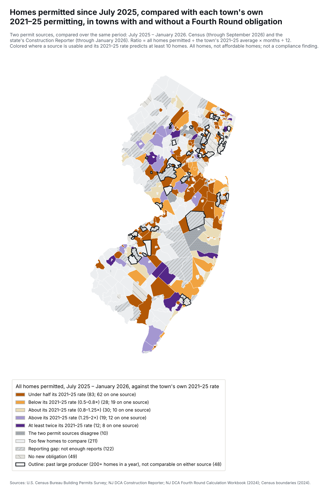
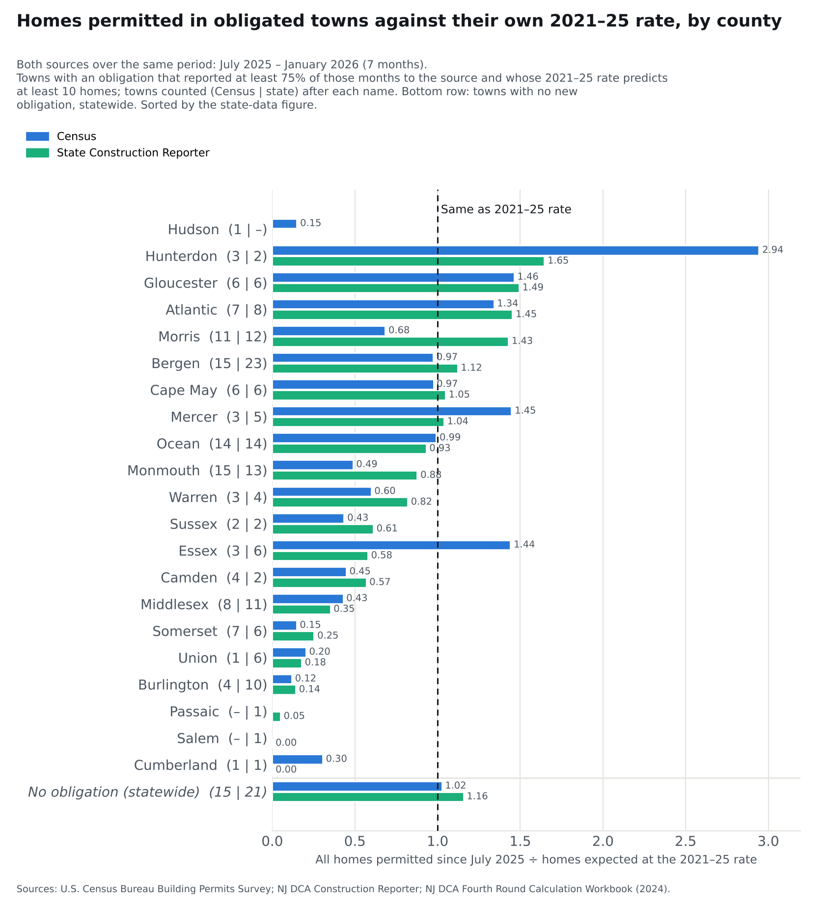

# Homes Permitted Where New Jersey's Fourth Round Obligations Are

**Swapnil Boyapati** · October 2026, revised November 2026 (v4) · *Unassembled public records*, project 1

[](out/summary.json)
[](out/summary.json)
[](https://github.com/SBoyapati13/nj-housing-pace/actions/workflows/update.yml)
[](https://sboyapati13.github.io/nj-housing-pace/)

[](https://sboyapati13.github.io/nj-housing-pace/)

*Figure 1. All homes permitted since July 2025 in every New Jersey town, as a share of what the town's own 2021–25 rate predicts for the same months. Both permit sources are compared over the same window. A town is colored when its comparable sources agree, when they are one band apart (shown in the band nearer "about the same"), or from its only comparable source; it is gray when the sources are two or more bands apart, when its past rate predicts too few homes to compare, or when it has a reporting gap. A dark outline marks past large producers that can't be compared on either source. Redrawn automatically with each release. **Click the map to open the interactive version**, where you can search for a town and see both sources side by side.*

---

## Abstract

New Jersey's 2024 Affordable Housing Law assigns 515 municipalities a combined 80,798 units of new ("prospective need") affordable housing for 2025–2035 [3, 4, 6]. This project puts each town's obligation next to the homes it has permitted, and asks whether permitting is happening where the obligations are, and whether towns with obligations are permitting more homes than they used to.

Town-level permit counts turn out to be the hard part. New Jersey has two public sources, and they often disagree:

- The **U.S. Census Bureau's Building Permits Survey** fills in towns that don't report with estimates. In New Jersey the estimated share of permitted homes has swung from under 1% (2019) to 38% (2015), and was 24–36% in each year from 2023 to 2025. Jersey City reported no months to Census in 2024 or 2025.
- The **state's Construction Reporter** marks towns that don't report as missing rather than estimating them, but runs about eight months behind, and some of its zeros are missing reports in disguise.
- For 2025 the two sources total 27,661 (Census, revised) and 19,865 (state, with 57 towns marked missing for the year; 18,973 if towns with a missing December report are also left out, as this project does). For individual towns that reported fully to both, they can differ several-fold: Wall Township 2023, 592 vs. 177.

So the project shows both sources side by side, uses a source for a town only when the town reported most months to it, compares the sources over the same period, and measures each town against its own past: homes permitted since July 2025 divided by what the town's 2021–25 rate predicts for the same months. The figures are all homes permitted, not affordable homes; neither source tags affordable units. At the first release under this method (v4; Census data through September 2026, state data through January 2026, shared window July 2025 – January 2026):

- Towns with a Fourth Round obligation permitted **80%** of their 2021–25 rate on state data and **82%** on Census data. Towns with no new obligation permitted **116%** and **102%**.
- **172 of 515** obligated towns can be placed in a band, 61 of them on both sources. **333** can't be compared on either source yet: 211 because their past rate predicts fewer than 10 homes over seven months (a number that falls as months accumulate), and 122 for too few reports.
- Where both sources could be compared for a town (71 towns), they put it in the same band 37 times, one band apart 24 times and two or more bands apart 10 times.
- About **36–37%** of all homes permitted were in the 49 towns that carry no new obligation, mostly by design (47 are Qualified Urban Aid municipalities).

**Coverage.** Obligated towns that can be compared on at least one source hold 55% of the obligation (47% on state data, 36% on Census, 28% on both). 48 towns that permitted 200 or more homes in a fully reported year since 2015 can't be compared on either source; 37 of them have an obligation, together holding 12% of it, among them Secaucus, Springfield, Hillsborough and Princeton (all 48 are listed in the Live status and outlined on the map). The largest, Jersey City (6,365 homes in its peak year), carries no obligation and reported no months to either source in the window, so the comparison group is missing the state's biggest producer. How the two sources relate is also unresolved (§2): the Census Bureau says it receives a monthly file from DCA, and DCA says it sends Census nothing.

**How to read this.** This is an indicator built from building permits. It doesn't assess whether any town is complying with its obligation: towns meet obligations in several ways permits don't capture (credits, 100%-affordable projects, adjustments), and compliance is decided through the Affordable Housing Dispute Resolution Program and the courts. A ratio below 1 can reflect land, infrastructure and market conditions as much as local policy, a town's own past is a reference point rather than a target, and plans adopted in 2025–26 may not show up in permits for some time.

This is a living analysis. A pipeline checks both permit sources and the state's completions data every week, rebuilds every figure when anything new is published, and reports when, and whether, the question can still be answered (§7.2). Every update is logged, and every number can be rebuilt from public files with one command. The method was corrected on October 13, 2026 after an error review, and again after an independent check of the correction; the CHANGELOG lists what was wrong, what changed, and which changes were made after seeing results. In November 2026, v4 replaced the earlier pace measure (homes permitted × 20%, against the obligation pro-rated to date) with each town's ratio to its own 2021–25 rate; v4 was registered before any of its results were computed.

<!-- LIVE:START -->
## Live status

*Rewritten automatically whenever either permit source publishes. Census data through September 2026; state data through January 2026. Every update is logged in `data/runs.jsonl`.*

**Interactive map:** https://sboyapati13.github.io/nj-housing-pace/ (search any town to see both sources side by side).

**All homes permitted, July 2025 – January 2026, against each town's own 2021–25 rate.**

- Towns with a Fourth Round obligation permitted **80%** of their 2021–25 rate on state data and **82%** on Census data.
- Towns with no new obligation: **116%** (state) and **102%** (Census).
- **Coverage:** towns holding 55% of the obligation can be compared on at least one source (47% state, 36% Census). 48 large past producers can't be compared on either source, including Jersey City, Long Branch city, Weehawken township.

These are all homes permitted, not affordable homes: neither source tags affordable units. Implementing ordinances were due in March 2026, so most projects under the new zoning had not reached the permit stage in this window.

| | State Construction Reporter | Census Building Permits Survey |
|---|---|---|
| Period | July 2025 – January 2026, shared window (7 months) | same |
| Obligated towns comparable (share of obligation) | 139 (47%) | 114 (36%) |
| All homes permitted in those towns | 6,175 | 4,242 |
| At their 2021–25 rate it would be | 7,684 | 5,181 |
| **Ratio, obligated towns** | **80%** | **82%** |
| Ratio, towns with no obligation (towns compared) | 116% (21) | 102% (15) |

A source is comparable for a town when the town reported at least 75% of the window's months to it, has a 2021–25 baseline from it (4 of 5 fully reported years), and that baseline predicts at least 10 homes over the window. Each source over its own full period, all homes permitted in obligated towns: state data 6,720 homes through January 2026 (313 towns with usable reports); Census 22,324 homes through September 2026 (all 514 towns with a Census record; 37% Census estimates).

**Map classes** (Figure 1).

| Class | Towns |
|---|---|
| Under half its 2021–25 rate | 83 |
| Below its 2021–25 rate (0.5–0.8×) | 28 |
| About its 2021–25 rate (0.8–1.25×) | 30 |
| Above its 2021–25 rate (1.25–2×) | 19 |
| At least twice its 2021–25 rate | 12 |
| The two permit sources disagree | 10 |
| Too few homes to compare | 211 |
| Reporting gap: not enough reports | 122 |
| No new obligation | 49 |

Of the 172 colored obligated towns, 61 rest on both sources and 111 on one comparable source. Where both sources were comparable (71 towns), they put the town in the same band 37 times, one band apart 24 times (shown in the band nearer "about the same") and two or more bands apart 10 times. 12 are colored from Census alone with no homes actually reported. 333 obligated towns can't be compared on either source: 211 have too few homes to compare and 122 have a reporting gap.

**Past large producers that can't be compared** (outlined on the map; most homes permitted in a fully reported year 2015–2024 in brackets): Jersey City (6,365, no obligation); Long Branch city (1,062, no obligation); Weehawken township (946, no obligation); Hoboken city (692, no obligation); Elizabeth city (676, no obligation); Secaucus town (643); City of Orange township (622, no obligation); Atlantic City (503, no obligation); Springfield township (482); Hillsborough township (416); Wood-Ridge borough (407); Evesham township (392); Pennsauken township (380, no obligation); Princeton (379); Highland Park borough (368); Westampton township (363); Bound Brook borough (353); Boonton town (351); Tinton Falls borough (348); Delran township (340); West Orange township (326); Carlstadt borough (314); Washington township (308); Jackson township (304); Trenton city (298, no obligation); Garwood borough (291); Montclair township (290, no obligation); Absecon city (279); Mount Arlington borough (274); Gloucester township (268); Bogota borough (267); Fairview borough (259); North Brunswick township (257); Roselle borough (244, no obligation); Totowa borough (240); Maplewood township (237); Mendham borough (232); Bridgewater township (229); Berkeley Heights township (228); Englewood city (221); Cedar Grove township (219); Cranford township (219); Flemington borough (212); Caldwell borough (212); Ridgewood village (207); Wyckoff township (207); Clinton town (207); Berlin borough (205).

32 obligated towns have a state figure of 0 for the window that their Census reports don't confirm; those zeros are treated as not reported (§3).

**Final obligation numbers.** 14 towns have a final or adopted number on file (10 recorded as settled, court-ordered or accepted as calculated; see `evidence` in `data/raw/obligation_final.csv`). v4 uses DCA's calculation for every town (`obligation_source` = "dca"); the ratios above don't depend on obligations except to sort towns into the two groups.

**Reported completions** (certificates of occupancy, NJ DCA; through January 2026):
- 9,735 homes reported completed since July 2025 in the 384 towns not marked missing in the state's files.
- Over 2015–2024, reported completions equalled **71%** of homes permitted (state data, same agency and town codes), in the 282 towns that reported both every year. The gap mixes projects still under way, permits never built and incomplete reporting; the data can't separate them.
- Homes permitted in 2024–25 minus homes reported completed in 2024–25: **19,172** across 341 towns, a rough size of the recent pipeline.
- 90 towns are marked missing in the state's completions file for the latest full year and are left out.

*Sensitivity, not a measure of progress:* if 20% of the homes permitted in obligated towns were affordable, they would equal 38% (state) and 44% (Census) of the obligation pro-rated to date, each source over its own period (39% and 44% with final numbers where settled). This feeds no class, count or chart.

First run under the current method: no earlier release to compare against yet.



*Figure 2. The same ratio by county, both sources over the same window, counting only obligated towns comparable on each source; the bottom row is towns with no new obligation, statewide.*

**System health.** Overall: **WARN**

| Check | Status | Detail |
|---|---|---|
| round window | OK | Fourth Round active: month 15 of 120 (Census), 7 (state data). |
| census freshness | OK | Latest Census data is 2 months old (normal lag is 1–3). |
| state permits freshness | OK | Latest state permit data (NJ DCA) is 10 months old (normal lag is 8–10). |
| census format | OK | 41 columns (expected 41), 562 NJ places (expected 550+). |
| town match | OK | 564 of 564 towns matched to at least one permit source. |
| reporting coverage | OK | Towns holding 74% of the obligation have usable state permit data since July 2025, and 54% reported at least 75% of months to Census. Warns only when neither source covers 60%. |
| comparison coverage | WARN | Obligated towns holding 55% of the obligation can be compared with their 2021–25 rate on at least one source (47% state, 36% Census, 28% both). Warns under 60%. |
| source agreement | OK | Of 71 obligated towns comparable on both sources, 37 fall in the same band, 24 are one band apart and 10 are two or more bands apart. |
| negative values | OK | 0 towns had negative homes permitted since July 2025 (clipped to 0). |
| obligation source | OK | DCA obligation workbook unchanged upstream. |
| completions freshness | OK | Latest completions data (NJ DCA certificates of occupancy) is 10 months old (normal lag is 8–10). Completions are a secondary layer. |
| proxy validity | MANUAL | Figures are all homes permitted; neither source tags affordable units. Reviewed by hand each month (data/review_log.md). |

*Run history under the current method (last 12 updates; full log, including superseded methods, in `data/runs.jsonl`):*

| Census data through | State data through | Run date | Ratio, obligated (state) | Ratio, obligated (Census) | Coverage | Large-producer gaps |
|---|---|---|---|---|---|---|
| 2026-09 | 2026-01 | 2026-11-23 | 80% | 82% | 55% | 48 |
<!-- LIVE:END -->

## 1. Background

### 1.1 The Mount Laurel doctrine

In 1975 the New Jersey Supreme Court held that a developing municipality must, through its zoning, "presumptively make realistically possible an appropriate variety and choice of housing," at least to the extent of its "fair share of the present and prospective regional need therefor" [1, 67 N.J. at 174]. The Court strengthened the doctrine in 1983 [2], and the Fair Housing Act of 1985 and the Council on Affordable Housing (COAH) were then built to carry out that duty. After the Supreme Court declared COAH inoperative in 2015 [4, p. 5], obligations were set town by town in the courts until the 2024 reform.

The obligation is to provide a *realistic opportunity* for affordable housing, chiefly through zoning. It is not a quota of permits. That is why this project's measure is an indicator, not a compliance test.

### 1.2 The 2024 Affordable Housing Law

P.L.2024, c.2, signed March 20, 2024, replaced that system. The Legislature declared that "the Council on Affordable Housing shall be abolished" [3]. It moved the calculation to a fixed statutory formula run by the Department of Community Affairs (DCA) and created an Affordable Housing Dispute Resolution Program to settle challenges [3, 4]. Three features of the formula matter for this analysis.

**Regional need comes from household growth.** The law states that household change, "if positive, shall be divided by 2.5 to estimate the number of low- and moderate-income homes needed" [3]. DCA's application of this produced 84,698 units of regional prospective need statewide [4, p. 10].

**Urban-aid municipalities are exempt.** In the law's words: "If a municipality is a qualified urban aid municipality, the municipality shall be exempt from responsibility for any fair share prospective need obligation for the upcoming 10-year round" [3]. DCA identified 47 such municipalities in 13 counties [4, p. 10]. Two more towns (Tavistock and Walpack) have a calculated obligation of zero.

**Obligations are capped.** A town may lower its number to avoid an obligation requiring "a realistic opportunity for more than 1,000 housing units," or one exceeding "20 percent of the total number of households" [3; 4, p. 18]. After the cap, the statewide total is 80,798 [6].

### 1.3 Where the process stands

Towns could accept DCA's number or adopt their own by resolution, with challenges due by the end of February 2025. By then, 282 towns had accepted DCA's figures and 158 had used their own calculations, 68 of which were challenged [7]. In January 2026, Fair Share Housing Center, an advocacy organization that is a party to many of these cases, reported about 380 municipalities with compliant plans and about 40 without agreements, calling the result "nothing short of a sea change" [8].

As of January 2026, the end of this project's first v4 window: implementing ordinances were due in March 2026, so most projects under the new zoning had not yet reached the permit stage in this window.

The process has also been contested. A coalition led by Montvale sued to block the law; its mayor said the mandates "from Trenton go too far" [9]. Montvale's own dispute shows how much numbers can move: DCA assigned it 348 units; the Dispute Resolution Program recommended 255, noting that "Prospective Need is not mandated to be perfect" [10]; and the Superior Court then fixed the number at 205 [15].

Final numbers are recorded for the 15 largest obligations, and for Montvale, where they could be found (`data/raw/obligation_final.csv`, with document, link, quote and an `evidence` column for each). Most "court order" and "settlement" statuses come from town documents or news reports that *describe* the order or settlement; only Montvale's order was read directly.

| Town | State calculation | Final / adopted | Basis | Evidence |
|---|---|---|---|---|
| Paramus | 1,000 | 1,000 | Accepted the state number (its plan reports vacant-land capacity of 87) | Town housing plan |
| Secaucus | 1,000 | 1,000 | Court order, Apr 2025 | Council resolution describing it |
| Wayne | 1,000 | 1,000 | Court order, Mar 2025 | Draft housing plan describing it |
| Roxbury | 989 | 358 | Adopted resolution, Jan 2025; outcome of any challenge unknown | The resolution |
| South Brunswick | 959 | 1,070 | Settlement, Sep 2024 | Town housing plan describing it |
| Jackson | 954 | 1,000 | Settlement, Dec 2024 | Final-draft housing plan describing it |
| Linden | 787 | 738 | Adopted resolution, Jan 2025; outcome of any challenge unknown | The resolution |
| Monroe (Middlesex) | 751 | 460 | Settlement | Town housing element describing it |
| Wall | 744 | 650 | Court order, Apr 2025 | Letter resubmitting its plan |
| Franklin (Somerset) | 714 | 659 | Settlement, Apr 2025 | News report |
| Hardyston | 674 | 647 | Settlement filed with the court, Dec 2025 | Plan amendment describing it |
| Toms River | 670 | 649 | Settlement pending, Mar 2026 | News report |
| West Windsor | 661 | 392 | Adopted resolution, Jan 2025; outcome of any challenge unknown | The resolution |
| Montvale | 348 | 205 | Court order, Jun 2025 | The order [15] |
| Edison, Old Bridge | 727, 685 | – | Not found | – |

The state's calculation is used for every town (`obligation_source` = "dca") because it's available and comparable everywhere. Under v4 the obligation decides only which group a town is in, obligated or not; final numbers enter only the affordable sensitivity figure (§3, item 12). The 158 towns that adopted their own numbers aren't covered, so that figure is narrow.

### 1.4 What this project adds

Obligations come from DCA. Permits come from two agencies with different town identifiers, different reporting rules and different lags, and they disagree. No public source puts each town's obligation next to both permit counts, with each town's reporting record. This project makes that join, and treats the disagreement between the sources as a finding in its own right.

## 2. Data

| Source | What it contributes | Coverage |
|---|---|---|
| NJ DCA, *Fourth Round Calculation Workbook*, "Final Summary" sheet [6] | Present need, prospective need (capped), 2020 households, county-subdivision FIPS, DCA town code | 564 municipalities |
| NJ DCA, *Fair Share Housing Obligations for 2025–2035: Methodology and Background* [4] | Definitions and formula; source of quoted methodology | — |
| U.S. Census Bureau, Building Permits Survey, place files [5] | Housing units authorized, by structure type; months each town reported; Census estimates for unreported months | Revised annual files 2015–2025; preliminary June and December 2025; latest year to date |
| NJ DCA, *Construction Reporter*: housing units authorized by building permits [14] | Housing units authorized by town; towns that didn't report marked "Missing Data" | Revised yearly files 2015–2024; December, June 2025 and latest year-to-date files |
| NJ DCA, *Construction Reporter*: certificates of occupancy [13] | Reported completions, year to date | 2015 to the latest published month |
| Municipal resolutions, plans, a court order and news reports (listed in `data/raw/obligation_final.csv`) | Final or adopted obligations for 16 towns | 13 of 16 found |
| U.S. Census Bureau, cartographic boundary files, NJ county subdivisions, 2024 [12] | Town boundaries for the map | 564 municipalities |

On estimates, the Census Bureau states that its figures "are based on received reports for places in the monthly survey and imputed activity for non-reporters and those not surveyed monthly" [11]. Every place file has a "months reported" field, which this project uses to separate a town's own reports from Census estimates. How the two sources are connected is unresolved, and the two agencies describe it differently. The Census Bureau's Residential Construction Branch says some New Jersey places report to it directly and that, for those that don't, it receives a monthly data file from DCA; months received that way count as reported in "months reported", and a place that stops reporting is imputed from its last report indefinitely (by email, October 20 and November 20, 2026). DCA's Division of Codes and Standards says it does not send its raw monthly data to the Census Bureau or any other third party; that the raw municipal data are public on the state's open-data portal (NJ Construction Permit Data), where Census staff may be getting them; and that the Construction Reporter is the audited and summarized version of that data (by email, October 20 and November 23, 2026). This project doesn't try to settle which account is right: it treats "months reported" as the field records it and keeps the two sources separate.

Census matches towns by county and minor-civil-division code; the state by its own four-digit town code. Both join to the obligation table, which carries both codes. All 564 towns match at least one source. Netcong stops appearing in Census files after 2017 and Tavistock has no Census record; both are in the state data.

## 3. Methods

The current method (v4) is recorded in `CHANGELOG.md`. It was registered on November 23, 2026, before any v4 results were computed, and implemented as registered. It keeps v3.2's sources, reporting rules and shared window, and replaces the pace measure with each town's ratio to its own 2021–25 rate. Earlier versions are listed there too, including what was wrong with them: v3 was registered on October 13, 2026 before its results; three v3.1 corrections were registered after v3 results had been computed, in response to an independent check; v3.2 (October 19) judged "too early to read" on the shared period.

1. **Obligation.** For each town: DCA prospective need after the 1,000-unit / 20% cap, covering July 2025 – June 2035 (`obligation_source` = "dca" for every town). The law states the round begins "with the fourth round on July 1, 2025" [3]. Under v4 the obligation sorts towns into two groups, obligated and not; it isn't the denominator of any class.
2. **Census permits.** Full years come from the revised annual files Census publishes each May. The current year comes from the latest year-to-date file. July–December 2025 = the revised 2025 total × the share of the preliminary 2025 total that fell after June.
3. **State permits.** July–December 2025 = December minus June 2025 year-to-date totals, counted as 6 reported months when neither file marks the town's total or processing date "Missing Data". The current year = the latest year-to-date total, counted as all its months on the same condition. Full years use the state's revised yearly files. A state figure of exactly 0 counts as a report only if the town reported at least 75% of the same months to Census and those reports total fewer than 5 homes; otherwise it's treated as not reported (in 60 town-years since 2015, by this project's reading of the state's markers, the state recorded 0 while the town reported 20 or more homes to Census for the full year).
4. **Usable source.** A source is used for a town only if the town reported at least 75% of the window's months to it. **Both sources are compared over the same window** (July 2025 through the latest month both have published); each source's figures over its own full period are shown alongside.
5. **Baseline, per source.** The town's average homes permitted per year over 2021–25, from fully reported years, with at least 4 of the 5 needed.
6. **Ratio to baseline, per source.** Expected homes = baseline × months in the window ÷ 12; ratio = homes permitted in the window ÷ expected. A source is *comparable* for a town when it is usable, has a baseline, and predicts at least 10 homes over the window. Bands: under 0.5 "well below its 2021–25 rate"; 0.5–0.8 "below"; 0.8–1.25 "about the same"; 1.25–2 "above"; 2 or more "at least twice".
7. **Map class**, in order: no obligation; both sources comparable and in the same band, that band; one band apart, the band nearer "about the same" (marked as one band apart); two or more bands apart, "sources disagree"; one comparable source, its band (marked in the town detail and counted separately in the Live status); a usable source with a baseline but fewer than 10 expected homes, "too few homes to compare"; otherwise "reporting gap".
8. **Past large producers.** A town's peak is its most homes permitted in a fully reported year 2015–2024 on either source. A town with a peak of 200 or more that isn't comparable on either source is outlined on the map and listed by name in the Live status, so large gaps in coverage are visible rather than hidden in gray.
9. **Completions.** Certificates of occupancy from the state, from the June 2025 report onward. A town-year is treated as missing where the state marks it "Missing Data" with a total of 0. The completion ratio and pipeline compare completions with *state* permits, so both sides come from the same agency.
10. **Statewide figures**, per source: homes permitted ÷ expected homes, summed over comparable towns, separately for obligated towns and towns with no obligation.
11. **Best year.** Each town's best fully reported year since 2015 is shown in the town detail as a plain number, for context. It feeds no class.
12. **Affordable sensitivity.** Much affordable housing in New Jersey comes from inclusionary development, where a share of new homes is reserved as affordable; the law names "mandatory set-asides or density bonuses" among the tools [3]. One labelled figure in the Live status asks: if 20% of the homes permitted in obligated towns were affordable, what share of the obligation pro-rated to date would they equal, with the state's calculation and with final numbers where they are recorded as a court order, settlement or accepted state number. It feeds no class, count or chart.

**Verification.** Town figures were checked by hand against raw rows, and every town was recomputed independently from the raw files before release (`data/review_log.md`). For example, Paramus: state data 91 (December 2025 year to date) − 69 (June 2025) + 6 (January 2026) = 28 homes since July 2025, against a 2021–25 state average of 86 a year, so 86 × 7 ÷ 12 = 50.2 expected and a ratio of 0.56 ("below"); on Census, 27 homes against 36.4 expected (0.74, also "below"). Wall: state 48 against 71.5 (0.67, below) and Census 93 against 216.4 (0.43, well below), one band apart, so shown as "below". Wayne has one fully reported baseline year on each source and no usable months in the window: reporting gap. Jersey City has no obligation and reported no months to either source in the window; its Census figure of 1,507 is entirely Census estimates. The statewide obligation was checked against the workbook's TOTAL row (80,798).

## 4. Baseline (2021–2025)

The original baseline (v1) used preliminary Census files and counted Census estimates as town activity. It is superseded; its numbers stay in `data/runs.jsonl` for the record and shouldn't be cited.

| 2021–25, towns with an obligation | State data | Census |
|---|---|---|
| Towns with at least 4 of 5 years reported | 419 | 295 |
| Average homes permitted per year in those towns | 16,337 | 10,567 |
| Share of all permitted homes in towns with no obligation | 28% | 31% |

The two sources cover different sets of towns, so their totals shouldn't be compared directly. These 2021–25 averages are the baseline each town's v4 ratio is measured against (§3, item 5).

The largest obligations, average homes permitted per year, 2021–25:

| Municipality | County | Obligation | State data | Census |
|---|---|---|---|---|
| Secaucus | Hudson | 1,000 | 7.0 | 7.0 |
| Wayne | Passaic | 1,000 | too few years reported | too few years reported |
| Paramus | Bergen | 1,000 | 86.0 | 62.4 |
| Roxbury | Morris | 989 | 19.2 | 28.6 |
| South Brunswick | Middlesex | 959 | 116.0 | 161.6 |
| Jackson | Ocean | 954 | too few years reported | too few years reported |
| Linden | Union | 787 | 513.4 | too few years reported |
| Monroe (Middlesex) | Middlesex | 751 | 244.8 | 305.4 |
| Wall | Monmouth | 744 | 122.6 | 371.0 |
| Edison | Middlesex | 727 | 111.8 | too few years reported |

*Listed for context, not as a ranking. State-calculated obligations; final numbers can differ (§1.3). Wayne's and Jackson's state records are mostly zeros that their Census reports don't confirm, so they count as not reported (§3, item 3). Linden's state average includes 2,044 homes in 2024; Census shows 72, of which 32 were reported over 10 months.*

## 5. Discussion

The statute deliberately puts prospective need where land, income and commercial growth are, and exempts dense, lower-income municipalities [3, 4]. In the first seven months of the round, obligated towns that can be compared permitted about 80% of their own 2021–25 rate on both sources, while comparable towns with no new obligation permitted at or above theirs (116% on state data, 102% on Census). Roughly 30–37% of the state's permitting, depending on source and period, happens in towns that carry no new obligation by design. None of that shows the formula is wrong, or that any town is out of compliance.

Two readings are possible, and the data can't separate them yet:

- **The zoning reading.** The obligation itself is the remedy. Compliance plans rezone sites, and implementing ordinances were due in March 2026. If rezoning works, obligated towns' ratio to their own past should rise from 2026 on, and rise relative to towns with no obligation. That is the comparison the ratio is built to track as months accumulate.
- **The capacity reading.** Obligated suburbs build little because of land, infrastructure or demand constraints, some of which towns argued before the Dispute Resolution Program [10]. If so, rezoning alone won't close the gap.

The data problem is a finding too. Two public agencies count the same permits and, for many towns, disagree by more than the effect being measured. Where both sources can be compared for a town over the same months, they put it in the same band 37 times out of 71 and two or more bands apart 10 times. Town-level claims about Mount Laurel progress built on either source alone, including this project's earlier versions, should be read with that in mind.

## 6. Limitations

- **All homes, not affordable homes.** Neither source tags affordable units, so the ratio counts every home permitted. A town can permit more than it used to without adding affordable homes, and the reverse. The 20% figure in the Live status is a labelled sensitivity, not a measure of progress.
- **A ratio to a town's own past is not a target.** A town that built little in 2021–25 can read "above" on one or two projects, and one that built heavily can read "below" while still permitting more than most. The obligation sets what's required; the ratio says only whether permitting changed.
- **Seasonality.** Expected homes spread a town's yearly average evenly across months, but permitting isn't even: in Census's preliminary 2025 file, 49.4% of the year's homes came after June. A short window can read high or low against an even split. Towns with no obligation share the same bias, which is one reason they are shown alongside.
- **The comparison group has gaps.** Only 21 towns with no obligation can be compared on state data and 15 on Census, and the largest, Jersey City, reported no months to either source in the window.
- **Other compliance routes.** Towns also comply through supportive housing, accessory units, rehabilitation (present need) and extensions of existing affordability controls. Permits capture only part of this.
- **The sources disagree, and both have gaps.** Census estimates for non-reporting towns can be far off; the state marks missing towns but some of its zeros are missing reports, and it runs about eight months behind, so the map's shared window is set by the state. Even towns that reported fully to both can differ widely, likely from timing and definitions (for example, when a large project's permits are counted).
- **One-source towns.** 111 of the 172 colored obligated towns rest on one comparable source. Their class is marked as such in the town detail and counted separately in the Live status.
- **Many towns can't be compared yet.** Because the shared window is short (7 months at the first v4 release), 211 obligated towns have a past rate that predicts fewer than 10 homes over it, and 122 have a reporting gap. The first count falls as months accumulate. Past large producers among them are outlined on the map and named in the Live status.
- **Census figures aren't checked the way state zeros are.** 12 towns are colored from Census alone with no homes actually reported over the shared window: their Census figure is zero, or estimates for months they didn't report.
- **State towns behind on reports.** A town that reported July–December 2025 but not yet January 2026 is usable on state data (6 of 7 months) and its missing month counts as 0, so its state figure leans low.
- **State calculations, not final numbers.** v4 uses DCA's calculation for every town. Because the obligation only decides which group a town is in, final numbers matter mainly for the sensitivity figure, and they are on file for only a few towns.
- **Small numbers.** For a town with a small past rate, one project changes its band. Towns whose past rate predicts fewer than 10 homes over the window are shown as too few to compare.
- **Permits aren't completions, and completions are under-reported.** The completions layer shows how many permitted homes were reported finished; towns that don't file can't always be told apart from towns with no completions.

## 7. How the system stays current

### 7.1 Pipeline

| Step | Script | What it does |
|---|---|---|
| Fetch | `src/fetch.py` | Checks the Census directory and the state's Construction Reporter pages, and downloads only new or revised files. Records size, Last-Modified time and SHA-256 hash in each source's `manifest.json`. A failed request keeps the previous copy and never writes an error into a manifest |
| Build | `src/build.py` | Computes every town's figures from both sources. Saves a snapshot per data vintage to `data/history/`; a revision of the same vintage is added alongside, never overwritten |
| Log | `data/runs.jsonl` | Adds one line per run whose inputs changed: the input hashes plus the headline numbers. Lines are only ever added, never edited |
| Health | `data/health.json` | The checks in §7.2, committed whenever they change, so a warning is published even when no new data arrives |
| Figures, map and report | `src/chart.py`, `src/map.py`, `src/web.py`, `src/report.py` | Redraw Figures 1–2, rebuild the interactive map (`docs/`) and its single-file copy (`out/web_preview.html`), and rewrite the Live status block |
| Source agreement | `src/source_agreement.py` | Compares the two permit sources year by year and over five or more years; writes `out/source_agreement.json` and `out/source_totals.csv` (figures for the note on how the sources disagree) |
| Schedule | `.github/workflows/update.yml` | Runs every Monday on GitHub Actions; commits only when a source published something new or the health status changed, then redeploys the map |

Census revises earlier months, and in May the annual files; the state revises with its yearly files. The fetcher re-checks every file it uses on each run, and a revision shows up as a new entry in the log.

### 7.2 When this question can no longer be answered

Each run checks whether the system can still answer its question honestly. If a STOP check fails, the README says so at the top of the Live status section instead of presenting stale numbers as current.

| Condition | How it's detected | Status |
|---|---|---|
| The round has ended (after June 30, 2035) | Census data later than June 2035 | STOP: the result becomes a retrospective; switch to Fifth Round obligations, which the law requires DCA to calculate |
| Census data stops arriving | Latest release more than 3 months old (WARN), more than 5 (STOP) | WARN / STOP |
| State permit or completions data stops arriving | More than 11 months old | WARN |
| Census changes the file format | Column count or number of NJ places changes | STOP |
| Towns no longer match the sources | Fewer than 560 of 564 matched | STOP |
| Neither source covers most of the obligation | Usable towns hold under 60% of the obligation on both sources | WARN |
| Too little of the obligation can be compared | Obligated towns comparable with their 2021–25 rate on at least one source hold under 60% of the obligation | WARN |
| DCA republishes the obligation workbook | Size of the upstream file differs from the pinned copy | WARN: reviewed by hand, never swapped in automatically |
| All homes permitted stop saying much about the obligation (final numbers diverge; compliance mostly through routes permits don't capture) | Can't be detected automatically | MANUAL: reviewed monthly in `data/review_log.md` |

To run it locally:

```
pip install -r requirements.txt
python3 src/update.py      # fetch → build → figures → map → README
```

Raw inputs are in `data/raw/`. DCA's 35 MB obligation workbook isn't stored in the repo. Its Final Summary sheet is pinned as `data/raw/dca_final_summary.csv`, with the original file's size and SHA-256 in `dca_pin.json`. `python3 src/pin_dca.py` downloads the workbook and regenerates both. Text copies of the statute and Census documentation used for the quotations are in `data/sources/`.

## References

1. *Southern Burlington County N.A.A.C.P. v. Township of Mount Laurel*, 67 N.J. 151 (1975). https://njlaw.rutgers.edu/collections/d_space/33/67_NJ_151.pdf
2. *Southern Burlington County N.A.A.C.P. v. Township of Mount Laurel*, 92 N.J. 158 (1983) (*Mount Laurel II*).
3. P.L.2024, c.2 (A4/S50), New Jersey Affordable Housing Law, approved March 20, 2024. https://pub.njleg.gov/Bills/2024/PL24/2_.HTM
4. NJ Department of Community Affairs, *Fair Share Housing Obligations for 2025–2035 (Fourth Round): Methodology and Background* (October 2024). https://www.nj.gov/dca/dlps/pdf/FourthRoundCalculation_Methodology.pdf
5. U.S. Census Bureau, Building Permits Survey, place-level files, Northeast Region. https://www2.census.gov/econ/bps/Place/Northeast%20Region/
6. NJ Department of Community Affairs, *Fourth Round Calculation Workbook*. https://www.nj.gov/dca/dlps/pdf/FourthRoundCalculation_Workbook.xlsx
7. Fair Share Housing Center, "Historic Success: 85% of New Jersey Towns Adopt Reasonable Affordable Housing Calculations Under New Law" (February 28, 2025). https://www.fairsharehousing.org/press-release/historic-success-85-of-new-jersey-towns-adopt-reasonable-affordable-housing-calculations-under-new-law/
8. Fair Share Housing Center, "New Affordable Housing Law Delivers Results: Nearly All NJ Towns Resolve Challenges by Dec. 31 Deadline" (January 5, 2026). https://www.fairsharehousing.org/press-release/new-affordable-housing-law-delivers-results-nearly-all-nj-towns-resolve-challenges-by-dec-31-deadline/
9. "Nine towns sue New Jersey to stop next round of affordable housing mandates," via AOL News. https://www.aol.com/news/nine-towns-sue-jersey-stop-140000029.html
10. *In re Borough of Montvale*, BER-L-000750-25, Affordable Housing Dispute Resolution Program, recommendation and statement of reasons (April 23, 2025). https://www.montvalenj.gov/media/uaoi45kb/mendez-decision.pdf
11. U.S. Census Bureau, "Building Permits Survey: Methodology." https://www.census.gov/construction/bps/methodology.html
12. U.S. Census Bureau, Cartographic Boundary Files, county subdivisions, New Jersey, 1:500,000 (2024). https://www2.census.gov/geo/tiger/GENZ2024/shp/cb_2024_34_cousub_500k.zip
13. NJ Department of Community Affairs, *Construction Reporter*: certificates of occupancy, monthly data. https://www.nj.gov/dca/codes/reporter/co2026.shtml (earlier years at co2015–co2025)
14. NJ Department of Community Affairs, *Construction Reporter*: housing units authorized by building permits. https://www.nj.gov/dca/codes/reporter/building_permits.shtml (monthly files under `/{year}m/` and `/{year}monthly/`)
15. Superior Court of New Jersey, Law Division, Bergen County, *In re Borough of Montvale*, BER-L-750-25, Decision and Order fixing Fourth Round obligations (effective June 12, 2025). https://www.montvalenj.gov/media/yjkcmbaf/6-12-25-montvale-trial-ct-order-set-rd-4-obligation.pdf

All sources accessed October 13, 2026.

---

*Research design, data sourcing, verification and interpretation by Swapnil Boyapati. Analysis code written with Claude (Anthropic) under the author's direction.*
