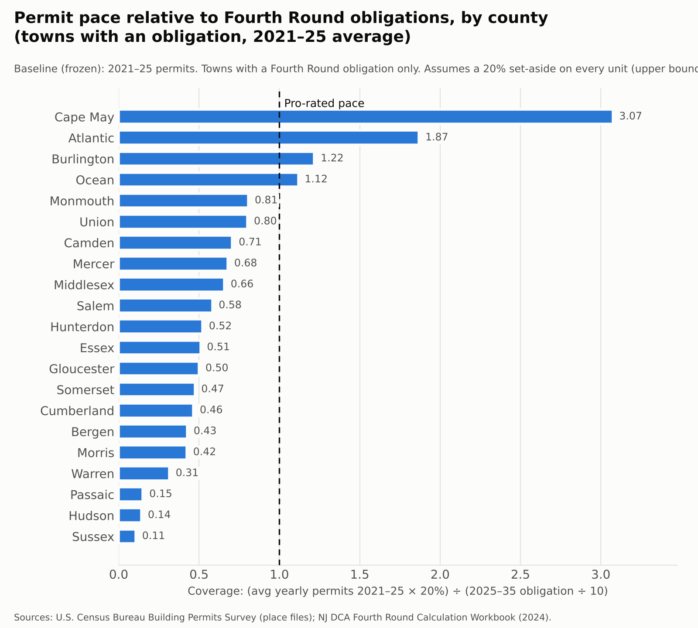

# Permit Pace and New Jersey's Fourth Round Affordable-Housing Obligations

**Swapnil Boyapati** · October 2026 · *Unassembled public records*, project 1

[](out/summary.json)
[](https://github.com/SBoyapati13/nj-housing-pace/actions/workflows/update.yml)
[](https://sboyapati13.github.io/nj-housing-pace/)

[](https://sboyapati13.github.io/nj-housing-pace/)

*Figure 1. Homes permitted since July 2025 in every New Jersey town, compared with its Fourth Round obligation pro-rated to date. Redrawn automatically with each Census release. **Click the map to open the interactive version**, where you can search for a town and see its numbers.*

---

## Abstract

New Jersey's 2024 Affordable Housing Law assigns 564 municipalities a combined 80,798 units of new ("prospective need") affordable housing for 2025–2035 [3, 4]. This project joins those obligations to U.S. Census Bureau building-permit records for every town [5] and asks whether recent construction is happening where the obligations are.

Statewide, recent building would nearly suffice. New Jersey permitted about 35,600 homes a year in 2021–2025; if every one carried a 20% affordable set-aside, that would yield about 7,100 affordable homes a year against the obligation's 8,080 a year. Geographically, though, building and obligation diverge sharply:

- **34%** of all permitted homes were in the 48 towns that owe no new affordable housing.
- Among the 514 towns that do, **290 permitted homes at less than half the pace their obligation implies**, even under that generous assumption. Together they hold 63% of the statewide obligation.

**How to read this.** This is an indicator built from building permits. It doesn't assess whether any town is complying with its obligation: towns meet obligations in several ways permits don't capture, and compliance is decided through the Affordable Housing Dispute Resolution Program and the courts. A low permit pace can reflect land, infrastructure and market conditions as much as local policy, and plans adopted in 2025–26 may not show up in permits for some time.

This is a living analysis. A pipeline checks the Census Bureau every week, pulls each new monthly release, and updates every town's progress since the round began on July 1, 2025. It also reports when, and whether, the question can still be answered (§7.2). The map above (Figure 1) and the **Live status** section below, with its county chart (Figure 2), are rewritten automatically, and every update is logged. Every number can be rebuilt from public files with one command.

<!-- LIVE:START -->
## Live status

*Updated automatically from the Census release covering January–August 2026. Every update is logged in `data/runs.jsonl`.*

**Interactive map:** https://sboyapati13.github.io/nj-housing-pace/ (search any town, hover for its numbers, switch between Fourth Round to date and the 2021–25 baseline). Rebuilt by `src/web.py` and redeployed on every update.

| Fourth Round to date (July 2025 – Aug 2026, 14 of 120 months) | |
|---|---|
| Homes permitted statewide | 35,461 |
| Implied affordable at 20% | 7,092 |
| Pro-rated obligation to date | 9,426 |
| **Statewide pace vs. pro-rated obligation** | **75%** |
| Towns at or above the pro-rated pace | 110 of 514 |
| Towns below half the pro-rated pace | 329 of 514 |
| Share of permits in exempt towns | 36% |
| Homes permitted, trailing 12 months | 30,305 |

**Best-year threshold.** For each town with an obligation: would reaching it by June 2035 take more than building every remaining year at the town's best year since 2015?
- **At a 20% set-aside:** yes for **240 towns**, holding 42,569 units of obligation. Another 12 would cross this threshold within 12 months if their recent pace continued.
- **Even if every new home were affordable:** yes for **63 towns**, holding 9,960 units.
- This compares obligations with past building patterns. It doesn't assess compliance: rezoning, 100%-affordable projects and other routes can exceed past patterns.
- Per-town status and dates are in `out/town_pace.csv` (`inclusionary_route_*`, `any_route_*`).

**Final obligation numbers.** 12 of the 15 largest obligations have a final or adopted number on record (9 settled, court-ordered or accepted as calculated); see `data/raw/obligation_final.csv` for each number's status, source and quote. Using those firm numbers in place of the state's calculation, statewide pace is **76%** (vs. 75%).

**Reported completions** (certificates of occupancy, NJ DCA; data through January 2026, which runs months behind permits):
- 9,419 homes reported completed since July 2025 in the 363 towns with complete reports for that period.
- Over 2015–2024, reported completions equalled **55%** of homes permitted, in the 423 towns that reported every year. The gap mixes projects still under way, permits never built and incomplete reporting; the data can't separate them.
- Homes permitted in 2024–25 minus homes reported completed in 2024–25: **23,329** across 469 towns, a rough size of the recent pipeline.
- 20 towns show zero completions in the latest full year despite substantial recent permitting; these are treated as likely missing reports and left out of the figures above.

First live run: no earlier release to compare against yet.


*Figure 2. The same pace measure, aggregated by county.*

**System health.** Overall: **OK**

| Check | Status | Detail |
|---|---|---|
| round window | OK | Fourth Round active: month 14 of 120. |
| census freshness | OK | Latest Census data is 2 months old (normal lag is 1-3). |
| census format | OK | 41 columns (expected 41), 562 NJ places (expected 550+). |
| town match | OK | 562 of 564 towns matched between DCA and Census. |
| obligation source | OK | DCA workbook unchanged upstream. |
| completions freshness | OK | Latest completions data (NJ DCA certificates of occupancy) is 9 months old; this source normally runs 8-10 months behind. Completions are a secondary layer, so this check never stops the system. |
| completions reporting | OK | 495 of 562 towns filed usable completions reports for the latest full year (88%). Missing reports, and zeros that look like missing reports, are left out of the completions figures. |
| proxy validity | MANUAL | Obligations are DCA-calculated (final numbers are tracked for the 15 largest only); permits are a proxy for affordable output. Reviewed by hand each month. |

*Run history (last 12 updates; full log in `data/runs.jsonl`):*

| Census vintage | Run date | Method | Homes since round start | Statewide progress | Towns below half |
|---|---|---|---|---|---|
| 2026-08 | 2026-10-13 | v1 (superseded) | 51,655 | 77% | 319 |
| 2026-08 | 2026-10-13 | v2 | 35,461 | 75% | 329 |
| 2026-08 | 2026-10-14 | v2.2 | 35,461 | 75% | 329 |
<!-- LIVE:END -->

## 1. Background

### 1.1 The Mount Laurel doctrine

In 1975 the New Jersey Supreme Court held that a developing municipality must, through its zoning, "presumptively make realistically possible an appropriate variety and choice of housing," at least to the extent of its "fair share of the present and prospective regional need therefor" [1, 67 N.J. at 174]. The Court strengthened the doctrine in 1983 [2], and the Fair Housing Act of 1985 and the Council on Affordable Housing (COAH) were then built to carry out that duty. After the Supreme Court declared COAH inoperative in 2015 [4, p. 5], obligations were set town by town in the courts until the 2024 reform.

### 1.2 The 2024 Affordable Housing Law

P.L.2024, c.2, signed March 20, 2024, replaced that system. The Legislature declared that "the Council on Affordable Housing shall be abolished" [3]. It moved the calculation to a fixed statutory formula run by the Department of Community Affairs (DCA) and created an Affordable Housing Dispute Resolution Program to settle challenges [3, 4]. Three features of the formula matter for this analysis.

**Regional need comes from household growth.** The law states that household change, "if positive, shall be divided by 2.5 to estimate the number of low- and moderate-income homes needed" [3]. DCA's application of this produced 84,698 units of regional prospective need statewide [4, p. 10].

**Urban-aid municipalities are exempt.** In the law's words: "If a municipality is a qualified urban aid municipality, the municipality shall be exempt from responsibility for any fair share prospective need obligation for the upcoming 10-year round" [3]. DCA identified 47 such municipalities in 13 counties [4, p. 10].

**Obligations are capped.** A town may lower its number to avoid an obligation requiring "a realistic opportunity for more than 1,000 housing units," or one exceeding "20 percent of the total number of households" [3; 4, p. 18]. After the cap, the statewide total is 80,798 [6].

### 1.3 Where the process stands

Towns could accept DCA's number or adopt their own. By the February 2025 deadline, 282 towns had accepted DCA's figures and 158 had used their own calculations, 68 of which were challenged [7]. In January 2026, Fair Share Housing Center reported about 380 municipalities with compliant plans and about 40 without agreements, calling the result "nothing short of a sea change" [8].

The process has also been contested. A coalition led by Montvale sued to block the law; its mayor said the mandates "from Trenton go too far" [9]. Montvale's own dispute shows how much numbers can move: DCA assigned it 348 units, and the Dispute Resolution Program recommended 255, noting that "Prospective Need is not mandated to be perfect" [10].

For the 15 largest obligations, this project records each town's final or adopted number where one could be found and verified (`data/raw/obligation_final.csv`, with source and quote for each):

| Town | State calculation | Final / adopted | Basis |
|---|---|---|---|
| Paramus | 1,000 | 1,000 | Accepted the state number (plan reports vacant-land capacity of 87) |
| Secaucus | 1,000 | 1,000 | Court order, Apr 2025 |
| Wayne | 1,000 | 1,000 | Court order, Mar 2025 |
| Roxbury | 989 | 358 | Adopted resolution, Jan 2025; outcome of any challenge unknown |
| South Brunswick | 959 | 1,070 | Settlement, Sep 2024 |
| Jackson | 954 | 1,000 | Settlement, Dec 2024 |
| Monroe (Middlesex) | 751 | 460 | Settlement |
| Wall | 744 | 650 | Court order, Apr 2025 |
| Franklin (Somerset) | 714 | 659 | Settlement, Apr 2025 (news report) |
| Hardyston | 674 | 647 | Settlement filed with the court, Dec 2025 |
| Toms River | 670 | 649 | Settlement pending, Mar 2026 (news report) |
| West Windsor | 661 | 392 | Adopted resolution, Jan 2025; outcome of any challenge unknown |
| Linden, Edison, Old Bridge | 787, 727, 685 | – | Not found |

The state's calculation remains the main measure because it's available and comparable for every town. Final numbers are used in a sensitivity figure (§3, item 8).

### 1.4 The gap this project fills

Obligations come from DCA. Permits come from the Census Bureau. The two are published separately and use different town identifiers, so no public source puts each town's obligation next to how much that town actually builds. This project makes that join.

## 2. Data

| Source | What it contributes | Coverage |
|---|---|---|
| NJ DCA, *Fourth Round Calculation Workbook*, "Final Summary" sheet [6] | Present need, prospective need (capped), 2020 households, county-subdivision FIPS | 564 municipalities |
| NJ DCA, *Fair Share Housing Obligations for 2025–2035: Methodology and Background* [4] | Definitions and formula; source of quoted methodology | — |
| NJ DCA, *Construction Reporter*: housing units certified (certificates of occupancy) by municipality [13] | Reported completions, year to date, by structure type | Municipalities that report; 2015 to the latest published month |
| Municipal resolutions, court orders, settlements and plans (listed in `data/raw/obligation_final.csv`) | Final or adopted obligations for the 15 largest | 12 of 15 found |
| U.S. Census Bureau, cartographic boundary files, NJ county subdivisions, 2024 [12] | Town boundaries for the map (Figure 1), joined on the same 10-digit FIPS | 564 municipalities |
| U.S. Census Bureau, Building Permits Survey (BPS), place-level annual files [5] | Housing units authorized by permit, by structure type (1, 2, 3–4, 5+ units) | NJ permit-issuing places, full years 2015 onward plus the latest year-to-date release (refreshed automatically) |

On imputation, the Census Bureau states that its estimates "are based on received reports for places in the monthly survey and imputed activity for non-reporters and those not surveyed monthly" [11]. This project uses those imputed totals, which are the Bureau's headline series.

## 3. Methods

The method was written down before any results were computed.

1. **Obligation.** For each town: DCA prospective need after the 1,000-unit / 20% cap, covering 2025–2035. Annual target = obligation ÷ 10.
2. **Building pace.** For each town: average yearly housing units authorized in 2021–2025, all structure types, imputed totals.
3. **Yardstick.** New Jersey produces much of its affordable housing through inclusionary development, where a share of market-rate units is reserved as affordable. The law names "mandatory set-asides or density bonuses" among the tools towns may use [3]. A uniform 20% set-aside is assumed as a generous upper bound.
4. **Coverage ratio** = (building pace × 0.20) ÷ annual target. At 1.0 or above, a town's recent pace could meet its obligation if every unit came with a 20% set-aside.
5. **Join.** Census county code + minor civil division code → 10-digit county-subdivision FIPS, matched to DCA's FIPS field. 562 of 564 towns matched. Netcong and Tavistock are not in the Census permit universe.
6. **Live extension** (specified October 13, 2026, before any month-to-month comparison was run). Each new Census release adds two metrics per town:
   - **Progress to date** = (homes permitted since July 1, 2025 × 0.20) ÷ (obligation × months elapsed ÷ 120). The law states the round begins "with the fourth round on July 1, 2025" [3]. A first version mistakenly started the clock in January 2025; the correction is recorded in `CHANGELOG.md` and in the run log.
   - **Trailing-12-month coverage** = (homes permitted in the last 12 months × 0.20) ÷ (obligation ÷ 10).

   - **Best-year threshold**, at two levels. For each town: affordable units still owed = obligation − (homes permitted since July 2025 × 0.20). The town has **passed the threshold at 20%** when reaching its obligation by June 30, 2035 would take more than building every remaining year at its best year since 2015, with 20% of new homes affordable. It has **passed the threshold for all homes** when that would be true even if *every* new home were affordable. For towns below the threshold, the system projects the month they would cross it if the trailing-12-month pace continued. A best year since 2015 is a historical yardstick, not a limit: rezoning and 100%-affordable projects can exceed past patterns.

   The 2021–2025 baseline in §4 stays frozen, so the original finding can always be compared with what happens next.
8. **Final obligations and completions** (specified October 13, 2026, before either was computed; logged in `CHANGELOG.md` as v2.2).
   - **Sensitivity to final numbers.** Where a court order, settlement or accepted state number exists, the final number replaces the state's calculation in a second statewide figure. Adopted resolutions with an unknown challenge outcome, and pending settlements, are recorded but not used.
   - **Reported completions since July 2025** = certificates of occupancy from the June 2025 year-to-date report through the latest month published. Only towns present in every complete report for that window are counted.
   - **Completion ratio, 2015–2024** = reported completions ÷ homes permitted, for towns that appear in every year's report. 2025 is excluded because recent permits haven't had time to finish.
   - **Two-year pipeline** = homes permitted in 2024–25 minus homes reported completed in 2024–25, for towns in both years' reports.
   - **Likely missing reports.** A town-year showing zero completions despite at least 100 homes permitted in the prior two years is treated as not reported. This rule was added after inspecting the data: Jersey City reported over 1,000 completions a year in 2019–2023 and zero in 2024–25.
   - Completions are a secondary layer: they don't change the map colors or the coverage ratio.
9. **Verification.** Town totals were hand-summed from raw Census rows (for example, Jersey City 2023 = 2,339 units; Wall Township 2024 = 387). The statewide obligation was checked against the workbook's TOTAL row (80,798).

## 4. Baseline results (frozen, 2021–2025)

### 4.1 Statewide totals nearly balance

| | Value |
|---|---|
| Statewide prospective need, 2025–2035 | 80,798 (8,080 / yr) |
| Homes permitted per year, 2021–2025 average | 35,625 |
| Implied affordable per year at 20% | 7,125 (88% of target) |
| Homes permitted Jan–Aug 2026 | 19,634 |

### 4.2 But building and obligation are in different places

- **Towns without new obligations account for a third of permits.** The 48 matched towns with zero prospective need account for **34%** of homes permitted in 2021–2025. Forty-seven of the 48 are Qualified Urban Aid municipalities. The largest builders among them are Jersey City (2,802 / yr), Newark (1,635), Lakewood (1,367), West New York (658) and Weehawken (641).
- **In most obligated towns, permit pace is below the pace the obligation implies.** Of the 514 towns with an obligation, 133 have coverage of 1.0 or more, 91 are between 0.5 and 1.0, and **290 are below 0.5**. Eighteen reported no permitted homes in 2021–2025. The below-0.5 group holds **51,168 units, or 63%** of the statewide obligation. Median coverage is **0.40**.
- **County pattern.** In **17 of 21 counties**, permit pace in obligated towns as a group is below the obligation's implied pace (Figure 3). Sussex (0.11), Hudson outside its urban-aid towns (0.14), Passaic (0.15) and Warren (0.31) are lowest. Only Cape May, Atlantic, Burlington and Ocean exceed 1.0.



*Figure 3. Baseline (frozen) coverage ratio by county, towns with a Fourth Round obligation only, 2021–2025. Sources: [5, 6].*

### 4.3 The largest obligations

| Municipality | County | Obligation (2025–35) | Permits / yr (2021–25) | Coverage |
|---|---|---|---|---|
| Paramus | Bergen | 1,000 | 62.4 | 0.12 |
| Secaucus | Hudson | 1,000 | 7.0 | 0.01 |
| Wayne | Passaic | 1,000 | 15.4 | 0.03 |
| Roxbury | Morris | 989 | 28.4 | 0.06 |
| South Brunswick | Middlesex | 959 | 161.6 | 0.34 |
| Jackson | Ocean | 954 | 50.0 | 0.10 |
| Linden | Union | 787 | 134.8 | 0.34 |
| Monroe (Middlesex) | Middlesex | 751 | 305.4 | 0.81 |
| Wall | Monmouth | 744 | 374.2 | 1.01 |
| Edison | Middlesex | 727 | 154.4 | 0.42 |

*Listed for context, not as a ranking. DCA calculated values; adopted or court-approved numbers may be lower (see §1.3). Several of these towns have adopted compliance plans whose effect won't show in permits yet.*

## 5. Discussion

The statute deliberately puts prospective need where land, income and commercial growth are, and exempts dense, lower-income municipalities [3, 4]. The pattern doesn't show that the formula is wrong, or that any town is out of compliance. It shows that **permits in the towns the formula assigns obligations to have so far run well below the pace those obligations imply**, while much of the state's permitting happens in urban-aid municipalities that carry no new obligation by design.

Two readings are possible, and the data can't separate them yet:

- **The zoning reading.** The obligation itself is the remedy. Mount Laurel compliance plans rezone sites, so pace should rise in obligated towns as plans take effect in 2026 and later.
- **The capacity reading.** Obligated suburbs build little because of land, infrastructure or demand constraints. Some of those are exactly what towns argued before the Dispute Resolution Program [10]. If so, rezoning alone won't close the gap.

Monthly Census releases make this testable: the coverage ratio can be re-run each month to see which reading the 2026–2028 data supports.

## 6. Limitations

- **Upper bound.** Not every market project is inclusionary, and rental set-asides are often below 20%. Real affordable output from market building is lower than shown.
- **Other compliance routes.** Towns also comply through 100%-affordable projects, supportive housing, accessory units, rehabilitation (present need) and bonus credits. Permits capture only part of this.
- **DCA numbers, not final numbers.** Many towns adopted lower numbers or had them adjusted, for example Montvale from 348 to 255 [10].
- **Permits aren't completions, and completions are under-reported.** Permits authorize construction; some projects are delayed or never built. The completions layer (§3, item 8) shows how many permitted homes were reported finished. But towns that don't file reports can't be told apart from towns with no completions, and the number of reporting towns has fallen from 558 (2015) to 516 (2025). The state also publishes this data months after Census publishes permits.
- **Imputation.** Census estimates activity for places that don't report every month [11].

## 7. How the system stays current

### 7.1 Pipeline

| Step | Script | What it does |
|---|---|---|
| Fetch | `src/fetch.py` | Lists the Census directory and the state's certificate-of-occupancy pages, finds the newest releases, and downloads only new or revised files. Records size, Last-Modified time and SHA-256 hash in `data/raw/bps/manifest.json` |
| Build | `src/build.py` | Recomputes the frozen baseline and the live metrics for all 564 towns. Saves a dated snapshot to `data/history/` |
| Log | `data/runs.jsonl` | Adds one line per run **whose inputs changed**: the input hashes plus the headline numbers. Lines are only ever added, never edited, so the log is the system's full history |
| Interactive map | `src/web.py` → `docs/` | Rebuilds the web map (`docs/index.html`, `docs/data/towns.json`) from the same outputs. The workflow deploys `docs/` to GitHub Pages after each run, so the live site always matches the latest data. Also writes `out/web_preview.html`, a single-file copy with the data built in |
| Charts, map and report | `src/chart.py`, `src/map.py`, `src/report.py` | Redraw Figures 1–3, rewrite the Live status block, and list towns that reached or dropped below the pro-rated pace since the previous release |
| Schedule | `.github/workflows/update.yml` | Runs every Monday on GitHub Actions and commits only when Census has published something new |

Census revises earlier months, and in May the annual files, so the fetcher re-checks every file it uses on each run. A revision shows up as a new entry in the log.

### 7.2 When this question can no longer be answered

Each run checks whether the system can still answer its question honestly. If a STOP check fails, the README says so at the top of the Live status section instead of presenting stale numbers as current.

| Condition | How it's detected | Status |
|---|---|---|
| The round has ended (after June 30, 2035) | Census vintage later than June 2035 | STOP: the result becomes a retrospective; switch to Fifth Round obligations, which the law requires DCA to calculate |
| Census data stops arriving | Latest release more than 3 months old (WARN), more than 5 (STOP) | WARN / STOP |
| Census changes the file format | Column count or number of NJ places changes | STOP |
| Towns no longer match between sources | Fewer than 560 of 564 matched | STOP |
| DCA republishes the obligation workbook | Size of the upstream file differs from the pinned copy | WARN: reviewed by hand, never swapped in automatically |
| The proxy stops measuring the real thing (adopted or court numbers diverge; compliance mostly through routes permits don't capture) | Can't be detected automatically | MANUAL: reviewed monthly |

The same weekly job publishes `docs/` to GitHub Pages, so the live map updates whenever new data arrives. One-time setup: repo **Settings → Pages → Source: GitHub Actions**.

To run it locally:

```
pip install -r requirements.txt
python3 src/update.py      # fetch → build → charts → README
```

Raw inputs are in `data/raw/`. DCA's 35 MB workbook isn't stored in the repo. Its Final Summary sheet is pinned as `data/raw/dca_final_summary.csv`, with the original file's size and SHA-256 in `dca_pin.json`. `python3 src/pin_dca.py` downloads the workbook and regenerates both. Text copies of the statute and Census documentation used for the quotations are in `data/sources/`.

## References

1. *Southern Burlington County N.A.A.C.P. v. Township of Mount Laurel*, 67 N.J. 151 (1975). https://njlaw.rutgers.edu/collections/d_space/33/67_NJ_151.pdf
2. *Southern Burlington County N.A.A.C.P. v. Township of Mount Laurel*, 92 N.J. 158 (1983) (*Mount Laurel II*).
3. P.L.2024, c.2 (A4/S50), New Jersey Affordable Housing Law, approved March 20, 2024. https://pub.njleg.gov/Bills/2024/PL24/2_.HTM
4. NJ Department of Community Affairs, *Fair Share Housing Obligations for 2025–2035 (Fourth Round): Methodology and Background* (October 2024). https://www.nj.gov/dca/dlps/pdf/FourthRoundCalculation_Methodology.pdf
5. U.S. Census Bureau, Building Permits Survey, place-level files, Northeast Region. https://www2.census.gov/econ/bps/Place/Northeast%20Region/
6. NJ Department of Community Affairs, *Fourth Round Calculation Workbook*. https://www.nj.gov/dca/dlps/pdf/FourthRoundCalculation_Workbook.xlsx
7. Fair Share Housing Center, "Historic Success: 85% of New Jersey Towns Adopt Reasonable Affordable Housing Calculations Under New Law" (February 28, 2025). https://www.fairsharehousing.org/press-release/historic-success-85-of-new-jersey-towns-adopt-reasonable-affordable-housing-calculations-under-new-law/
8. Fair Share Housing Center, "New Affordable Housing Law Delivers Results: Nearly All NJ Towns Resolve Challenges by Dec. 31 Deadline" (January 5, 2026). https://www.fairsharehousing.org/press-release/new-affordable-housing-law-delivers-results-nearly-all-nj-towns-resolve-challenges-by-dec-31-deadline/
9. "Nine towns sue New Jersey to stop next round of affordable housing mandates," via AOL News. https://www.aol.com/news/nine-towns-sue-jersey-stop-140000029.html
10. *In re Borough of Montvale*, BER-L-000750-25, Affordable Housing Dispute Resolution Program, statement of reasons (April 23, 2025). https://www.montvalenj.gov/media/uaoi45kb/mendez-decision.pdf
11. U.S. Census Bureau, "Building Permits Survey: Methodology." https://www.census.gov/construction/bps/methodology.html

12. U.S. Census Bureau, Cartographic Boundary Files, county subdivisions, New Jersey, 1:500,000 (2024). https://www2.census.gov/geo/tiger/GENZ2024/shp/cb_2024_34_cousub_500k.zip
13. NJ Department of Community Affairs, *Construction Reporter*: Certificates of Occupancy, monthly data. https://www.nj.gov/dca/codes/reporter/co2026.shtml (earlier years at co2015–co2025)

All sources accessed October 13, 2026.

---

*Research design, data sourcing, verification and interpretation by Swapnil Boyapati. Analysis code written with Claude (Anthropic) under the author's direction.*
